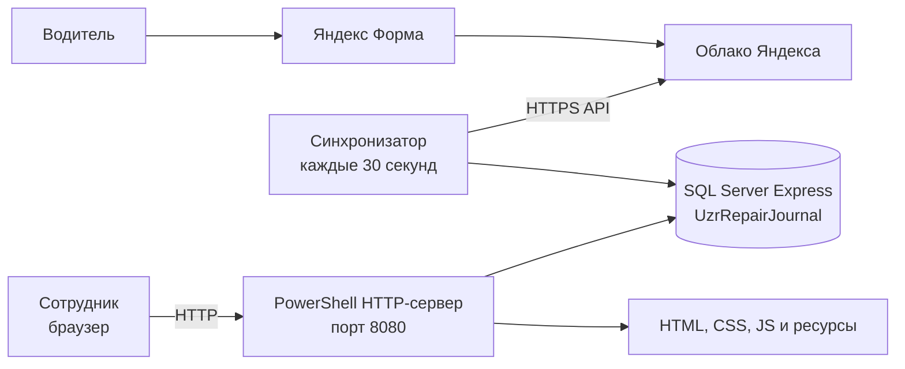
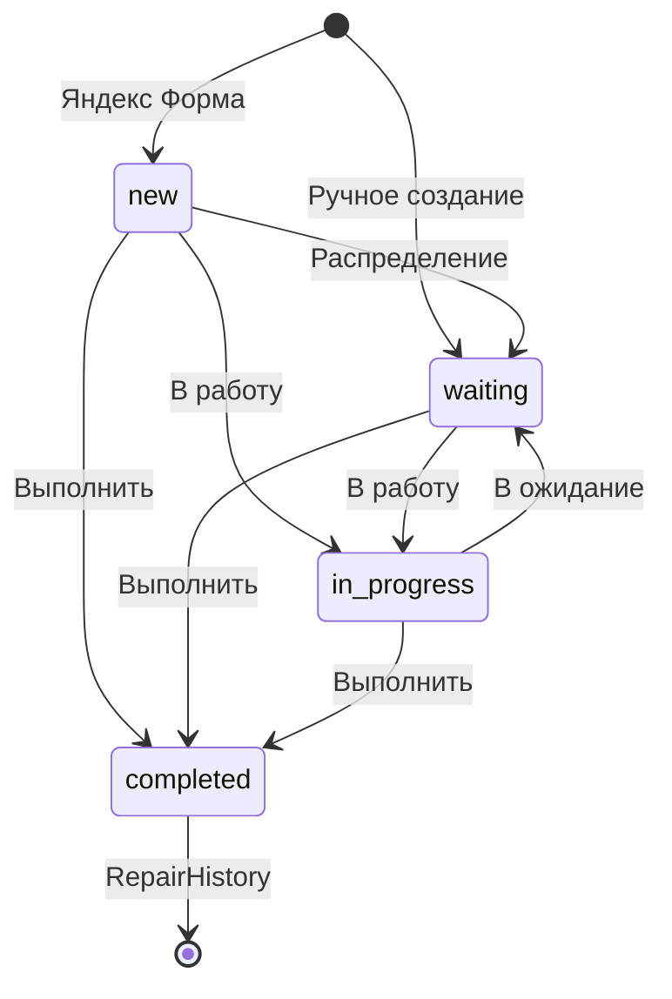
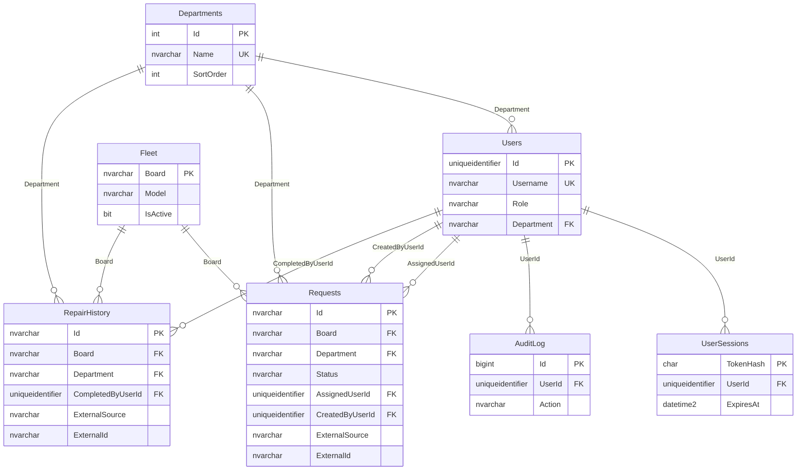
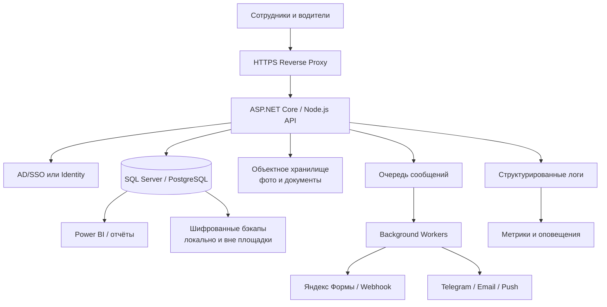

# Электронный журнал заявочного ремонта ТД №2

## Полное функциональное и техническое описание

**Проект:** электронный журнал заявочного ремонта троллейбусного депо №2  
**Организация:** МУП «Метроэлектротранс»  
**Документ актуален на:** 21 июня 2026 года  
**Рабочая база:** `UzrRepairJournal`  
**Текущая СУБД:** Microsoft SQL Server Express 64-bit, экземпляр `.\SQLEXPRESS`  
**Текущий адрес:** `http://localhost:8080/`

> Документ описывает фактическую реализацию. Секреты Яндекс Форм, пароли и токены здесь намеренно не приводятся.

---

## 1. Назначение системы

Система переводит бумажный журнал заявочного ремонта в единую электронную среду. Она решает четыре основные задачи:

1. Принимает заявки на неисправности троллейбусов.
2. Распределяет заявки между подразделениями и исполнителями.
3. Отслеживает состояние каждой активной заявки.
4. После выполнения переносит заявку в постоянную историю ремонтов.

Заявка создаётся сотрудником через журнал или водителем через Яндекс Форму. Все пользователи работают с одной базой SQL Server. Браузер не является основным хранилищем.

### 1.1. Что хранится

- парк троллейбусов и модели;
- признак активности борта;
- подразделения УЗР и Электронщики;
- активные заявки и статусы;
- назначенные исполнители;
- история выполненных ремонтов;
- пользователи, роли и сессии;
- журнал действий;
- состояние синхронизации Яндекс Форм;
- внешние ID ответов для защиты от дублей.

### 1.2. Что пока не реализовано

- склад и запчасти;
- трудозатраты;
- фотографии и вложения;
- push-уведомления;
- автономная работа браузера при выключенном сервере;
- встроенный HTTPS;
- автоматический бэкап по расписанию;
- запуск как Windows-служба;
- безопасный публичный доступ из интернета.

---

## 2. Текущее состояние

| Показатель | Значение |
|---|---:|
| Подразделения | 2 |
| Строки парка всего | 95 |
| Активные борта | 93 |
| Неактивные исторические борта | 2 |
| Активные заявки | 8 |
| Записи истории ремонтов | 464 |
| Пользователи | 1 |
| Активные серверные сессии | 1 |
| Записи аудита | 3 |
| Интервал опроса Яндекс Форм | 30 секунд |
| Интервал обновления интерфейса | 30 секунд |

Текущая установка работает на компьютере разработки. В итоговой схеме рабочий компьютер в депо должен быть единственным постоянно включённым сервером.

---

## 3. Термины

| Термин | Значение |
|---|---|
| Борт | Троллейбус, идентифицируемый бортовым номером |
| Заявка | Активное сообщение о неисправности |
| История ремонта | Завершённая заявка с описанием выполненной работы |
| Подразделение | УЗР или Электронщики |
| Исполнитель | Пользователь, привязанный к подразделению |
| Внешний ID | Идентификатор ответа Яндекс Форм |
| Контрольная точка | Последний просмотренный ответ Яндекс Форм |
| Сессия | Ограниченный по времени вход пользователя |
| Аудит | Запись о значимом действии |

---

## 4. Общая архитектура

Система состоит из браузерного интерфейса, PowerShell HTTP-сервера, SQL Server Express, фонового синхронизатора и Яндекс Формы.



### 4.1. Обмен данными

- Браузер получает HTML, CSS и JavaScript с HTTP-сервера.
- JavaScript обращается к API с префиксом `/api`.
- Сервер проверяет cookie, роль и подразделение.
- Сервер выполняет параметризованные SQL-запросы.
- JSON возвращается в UTF-8.
- Интерфейс обновляется каждые 30 секунд.
- Синхронизатор каждые 30 секунд проверяет Яндекс Формы.
- Новые ответы записываются в `Requests`.

### 4.2. Роль SQL Server

SQL Server обеспечивает единое состояние, транзакции, внешние ключи, уникальность внешних заявок, резервное копирование и возможность дальнейшего роста.

Файлы интерфейса не содержат рабочую историю. Очистка кэша браузера не удаляет заявки.

### 4.3. Текущая сеть

По умолчанию сервер слушает только:

```text
http://localhost:8080/
```

Сетевой режим включается параметром `-Lan`. Для него нужны URL ACL, правило Windows Firewall и постоянный IP. Порт SQL Server открывать в сети не требуется.

---

## 5. Компоненты проекта

### 5.1. Браузерный интерфейс

Файлы:

- `index.html` — структура экранов;
- `style.css` — оформление и адаптивная компоновка;
- `script.js` — авторизация, API, рендеринг, фильтры, звук и действия.

Используются обычные HTML, CSS и JavaScript без фреймворков и сборщика. Это снижает требования к слабому рабочему компьютеру.

### 5.2. HTTP-сервер

Файл `server/start-server.ps1`:

- запускает `System.Net.HttpListener`;
- раздаёт статические файлы;
- обрабатывает REST-подобный API;
- проверяет авторизацию и права;
- работает с SQL через `System.Data.SqlClient`;
- кодирует JSON в UTF-8;
- блокирует выход за корневую папку при запросе файла;
- безопасно обрабатывает отмену запроса или закрытие вкладки, не завершая серверный процесс;
- возвращает HTTP-коды ошибок.

### 5.3. SQL Server

Используется строка подключения:

```text
Server=.\SQLEXPRESS
Database=UzrRepairJournal
Integrated Security=True
TrustServerCertificate=True
```

Пароль SQL в проекте не хранится. PowerShell обращается к базе от имени Windows-пользователя, запустившего процесс.

### 5.4. Синхронизатор Яндекс Форм

Файл `server/sync-yandex-forms.ps1`:

- читает конфигурацию;
- выполняет исходящие HTTPS-запросы;
- разбирает колонки и ответы;
- извлекает борт и неисправность;
- добавляет заявку со статусом «Новая»;
- защищает от повторной загрузки;
- хранит контрольную точку;
- продолжает цикл после временной ошибки.

### 5.5. Вспомогательные скрипты

| Файл | Назначение |
|---|---|
| `setup-database.cmd` | Первый запуск схемы и импорт исходных данных |
| `start-all.cmd` | Запуск SQL, сайта и синхронизации |
| `start-local-server.cmd` | Запуск только HTTP-сервера |
| `start-yandex-sync.cmd` | Запуск синхронизации в цикле |
| `sync-yandex-forms-once.cmd` | Один проход синхронизации |
| `server/schema.sql` | Идемпотентная схема и миграции |
| `server/setup-db.ps1` | Создание БД и импорт исходного JSON |
| `server/update-schema.ps1` | Транзакционное обновление схемы |
| `server/backup-db.ps1` | Полная проверенная SQL-копия |
| `server/repair-text-encoding.ps1` | Исправление повреждённой кодировки |
| `server/start-all.ps1` | Оркестрация запуска |
| `server/yandex-forms.config.example.json` | Пример настроек без секретов |
| `server/yandex-forms.config.json` | Рабочие секреты; не публиковать |

### 5.6. Исходные данные и ресурсы

| Путь | Назначение |
|---|---|
| `data/initial-data.json` | 93 борта и 464 исходные записи истории |
| `assets/kazan_logo.png` | Логотип |
| `assets/trolleybus-body-clean.png` | Кузов троллейбуса |
| `assets/pole-clean.png` | Токоприёмник |
| `assets/wheel.png` | Колёса анимации |
| `assets/contact-segment.png` | Контактная сеть |
| `assets/new-request.mp3` | Звуковой сигнал |

---

## 6. Структура каталогов

```text
uzr_journal_app/
|-- index.html
|-- script.js
|-- style.css
|-- README.txt
|-- setup-database.cmd
|-- start-all.cmd
|-- start-local-server.cmd
|-- start-yandex-sync.cmd
|-- sync-yandex-forms-once.cmd
|-- assets/
|   |-- contact-segment.png
|   |-- kazan_logo.png
|   |-- new-request.mp3
|   |-- pole-clean.png
|   |-- trolleybus-body-clean.png
|   +-- wheel.png
|-- data/
|   +-- initial-data.json
|-- docs/
|   +-- TECHNICAL_DOCUMENTATION.md
+-- server/
    |-- backup-db.ps1
    |-- repair-text-encoding.ps1
    |-- schema.sql
    |-- setup-db.ps1
    |-- start-all.ps1
    |-- start-server.ps1
    |-- sync-yandex-forms.ps1
    |-- update-schema.ps1
    |-- yandex-forms.config.example.json
    +-- yandex-forms.config.json
```

Папки `backups` и `logs` могут появляться при обслуживании. Стандартный SQL-бэкап создаётся в каталоге резервных копий экземпляра SQL Server.

---

## 7. Роли и подразделения

Система разделяет:

- **роль** — разрешённые действия;
- **подразделение** — область данных исполнителя.

Одна роль `executor` подходит и УЗР, и Электронщикам.

### 7.1. Администратор

Код: `admin`.

Может видеть все данные, создавать, редактировать, перераспределять, выполнять и удалять заявки, изменять историю, парк и пользователей, сбрасывать пароли и смотреть аудит.

### 7.2. Начальник цеха

Код: `manager`.

Видит все подразделения, создаёт, редактирует, перераспределяет и выполняет заявки. Не удаляет заявки и историю, не управляет парком и пользователями.

### 7.3. Исполнитель

Код: `executor`.

Обязательно связан с УЗР или Электронщиками. Видит заявки и историю только своего подразделения. Может создать заявку в своей очереди, взять её в работу, вернуть в ожидание и выполнить.

### 7.4. Матрица прав

| Действие | Администратор | Начальник | Исполнитель |
|---|:---:|:---:|:---:|
| Видеть все подразделения | Да | Да | Нет |
| Создавать заявку | Да | Да | Только своё подразделение |
| Редактировать заявку | Да | Да | Только свою очередь |
| Перераспределять | Да | Да | Нет |
| Назначать исполнителя | Да | Да | Только себя через «В работу» |
| Менять статус | Да | Да | Да |
| Выполнять заявку | Да | Да | Да |
| Удалять заявку | Да | Нет | Нет |
| Редактировать историю | Да | Нет | Нет |
| Удалять историю | Да | Нет | Нет |
| Изменять парк | Да | Нет | Нет |
| Управлять пользователями | Да | Нет | Нет |
| Смотреть аудит | Да | Нет | Нет |

Интерфейс скрывает недоступные элементы, но основная защита находится на сервере. Изменение HTML в браузере не обходит роль.

---

## 8. Авторизация и сессии

### 8.1. Первый администратор

Если `Users` пуста, `GET /api/auth/status` сообщает, что требуется настройка. Создать первого администратора можно только с loopback-адреса серверного компьютера: `127.0.0.1`, `::1` или `localhost`.

### 8.2. Хранение пароля

Пароль не хранится открытым текстом:

1. Генерируется случайная соль 16 байт.
2. Вычисляется PBKDF2-HMAC-SHA256.
3. Используется 120 000 итераций.
4. Хеш 32 байта сохраняется в `PasswordHash`.
5. Соль сохраняется в `PasswordSalt`.

Минимальная длина сейчас — 4 символа. Для реальной эксплуатации безопаснее 10–12 символов.

### 8.3. Проверка входа

Логин переводится в нижний регистр. Сервер ищет активного пользователя, повторно вычисляет хеш и сравнивает байты без досрочного выхода. При неверных данных добавляется задержка 350 мс.

### 8.4. Сессионный токен

- 32 случайных байта;
- браузеру выдаётся Base64URL-токен;
- в БД хранится только SHA-256 токена;
- срок жизни — 12 часов;
- cookie: `HttpOnly` и `SameSite=Strict`;
- путь cookie — `/`.

Флаг `Secure` отсутствует, потому что текущий сервер работает по HTTP. После внедрения HTTPS он обязателен.

### 8.5. Выход и отключение

- выход удаляет текущую сессию;
- отключение пользователя удаляет все его сессии;
- сброс пароля удаляет все сессии пользователя;
- пользователь не удаляется физически, чтобы сохранить связи и смысл аудита.

### 8.6. Коды ошибок

| Код | Значение |
|---:|---|
| 200/201/204 | Успех |
| 400 | Ошибка входных данных |
| 401 | Нет действующей сессии |
| 403 | Недостаточно прав |
| 404 | Объект не найден |
| 409 | Конфликт состояния |
| 500 | Необработанная ошибка сервера |

---

## 9. Жизненный цикл заявки

### 9.1. Статусы

| Код | Отображение | Смысл |
|---|---|---|
| `new` | Новая | Только поступила, обычно из Яндекс Формы |
| `waiting` | Ожидает | Ожидает выполнения |
| `in_progress` | В работе | Исполнитель приступил |
| строка в `RepairHistory` | Выполнено | Активная заявка перенесена в историю |



### 9.2. Ручное создание

Пользователь вводит борт, подразделение, статус, исполнителя, неисправность и текст «от кого».

Сервер:

1. Проверяет право `createRequests`.
2. Проверяет активный борт.
3. Получает модель из `Fleet`.
4. Проверяет подразделение.
5. Для исполнителя принудительно использует его подразделение.
6. Проверяет назначенного пользователя.
7. Записывает `CreatedBy` и `CreatedByUserId`.
8. Создаёт аудит.

### 9.3. Перераспределение

Администратор или начальник меняет `Department` и `AssignedUserId`. Назначенный пользователь должен быть активным исполнителем выбранного подразделения.

### 9.4. В работу и в ожидание

На главной странице новая заявка подтверждается одним нажатием на кнопку «Принять в работу». Сервер меняет статус на `in_progress`; если действие выполняет исполнитель, заявка одновременно назначается на него.

Во вкладке «Активные заявки» кнопка «В работу» также устанавливает `in_progress`, а «В ожидание» устанавливает `waiting`. Заявки в ожидании не мигают, отображаются серыми и сортируются после новых заявок и заявок в работе.

### 9.5. Выполнение

Сервер открывает SQL-транзакцию:

1. Читает заявку.
2. Проверяет подразделение.
3. Создаёт `RepairHistory`.
4. Копирует борт, модель, подразделение, описание и внешние ID.
5. Записывает выполненную работу и `CompletedByUserId`.
6. Удаляет `Requests`.
7. Фиксирует транзакцию.
8. Создаёт аудит.

При ошибке вставки или удаления транзакция откатывается.

### 9.6. Удаление

Активную заявку или историю удаляет только администратор. Это физическое безвозвратное удаление с подтверждением и аудитом. В будущем желательно заменить его soft delete с обязательной причиной.

---

## 10. Парк

### 10.1. Деактивация

«Убрать из парка» меняет `IsActive` на `0`. Строка и история сохраняются.

### 10.2. Ограничение

Борт нельзя деактивировать при наличии активных заявок.

### 10.3. Переименование

При изменении номера внешние ключи активных заявок и истории обновляются через `ON UPDATE CASCADE`. API также синхронизирует модель в дочерних таблицах.

### 10.4. Неизвестный борт из Яндекс Формы

Если борта нет, синхронизатор создаёт активную строку с моделью «модель не указана». Заявка не теряется, а администратор позже исправляет модель.

---

## 11. Аудит

Записываются:

- первоначальная настройка;
- вход и выход;
- создание и изменение пользователя;
- сброс пароля;
- создание, изменение, выполнение и удаление заявки;
- изменение и удаление истории;
- добавление, изменение и деактивация борта.

Администратор видит последние 300 записей.

Аудит приложения не видит прямые SQL-изменения через SSMS и внешние скрипты, которые сами не записывают аудит. Поэтому доступ к SQL должен быть ограничен.

---

## 12. База данных

### 12.1. Общие сведения

| Параметр | Значение |
|---|---|
| Имя БД | `UzrRepairJournal` |
| Экземпляр | `.\SQLEXPRESS` |
| Редакция | SQL Server Express 64-bit |
| Наблюдаемая версия | 14.0.2110.2 |
| Основной файл данных | MDF |
| Журнал транзакций | LDF |
| Аутентификация приложения | Windows Integrated Security |

Схема находится в `server/schema.sql`. Скрипт идемпотентен: повторный запуск проверяет существование объектов и добавляет только недостающее.

### 12.2. Диаграмма связей



Таблица `YandexFormsSyncState` автономна и хранит одну строку технического состояния.

### 12.3. Таблица Departments

Назначение: справочник подразделений.

| Столбец | Тип | NULL | Ключ/значение | Смысл |
|---|---|:---:|---|---|
| `Id` | `int IDENTITY` | Нет | PK | Внутренний числовой ID |
| `Name` | `nvarchar(200)` | Нет | UNIQUE | Отображаемое и связующее имя |
| `SortOrder` | `int` | Нет | DEFAULT 0 | Порядок отображения |

Текущие строки:

- УЗР;
- Электронщики.

Связи построены по `Name`, а не по `Id`. Это упрощает текущий код и импорт, но в большой системе лучше ссылаться на неизменяемый ID.

### 12.4. Таблица Fleet

Назначение: справочник бортов.

| Столбец | Тип | NULL | Ключ/значение | Смысл |
|---|---|:---:|---|---|
| `Board` | `nvarchar(20)` | Нет | PK | Бортовой номер |
| `Model` | `nvarchar(200)` | Нет |  | Модель троллейбуса |
| `IsActive` | `bit` | Нет | DEFAULT 1 | Показывать ли борт в активном парке |

Почему `Board` является PK: в текущем бизнес-процессе номер уникален и является главным идентификатором. Риск: если номера переиспользуются во времени, в будущем нужен отдельный неизменяемый `VehicleId`.

### 12.5. Таблица Requests

Назначение: активная очередь.

| Столбец | Тип | NULL | Ключ/значение | Смысл |
|---|---|:---:|---|---|
| `Id` | `nvarchar(64)` | Нет | PK | GUID, сохранённый строкой |
| `Board` | `nvarchar(20)` | Нет | FK → Fleet.Board | Борт |
| `Model` | `nvarchar(200)` | Да |  | Копия модели для быстрого отображения |
| `Department` | `nvarchar(200)` | Нет | FK → Departments.Name | Текущий исполнительный участок |
| `Description` | `nvarchar(max)` | Нет |  | Описание неисправности |
| `CreatedBy` | `nvarchar(200)` | Нет |  | Отображаемый текст автора или «Яндекс Форма» |
| `CreatedAt` | `datetime2(0)` | Нет |  | Время создания |
| `ExternalSource` | `nvarchar(100)` | Да | Часть уникального индекса | Источник внешней заявки |
| `ExternalId` | `nvarchar(100)` | Да | Часть уникального индекса | ID ответа внешней системы |
| `Status` | `nvarchar(20)` | Нет | DEFAULT `waiting` | `new`, `waiting` или `in_progress` |
| `AssignedUserId` | `uniqueidentifier` | Да | FK → Users.Id | Назначенный исполнитель |
| `CreatedByUserId` | `uniqueidentifier` | Да | FK → Users.Id | Учётная запись создателя |
| `UpdatedAt` | `datetime2(0)` | Нет | DEFAULT `sysdatetime()` | Последнее изменение |

`CreatedBy` и `CreatedByUserId` не дублируют друг друга полностью:

- `CreatedBy` хранит исторический текст и поддерживает Яндекс Форму;
- `CreatedByUserId` даёт строгую ссылку на локального пользователя.

`Model` технически дублирует `Fleet.Model`. API синхронизирует её при изменении парка. В идеальной нормализованной схеме активная заявка могла бы получать модель JOIN-запросом, а история хранить снимок модели на момент ремонта.

### 12.6. Таблица RepairHistory

Назначение: завершённые работы.

| Столбец | Тип | NULL | Ключ/значение | Смысл |
|---|---|:---:|---|---|
| `Id` | `nvarchar(64)` | Нет | PK | ID исторической записи |
| `Board` | `nvarchar(20)` | Нет | FK → Fleet.Board | Борт |
| `Model` | `nvarchar(200)` | Да |  | Модель |
| `WorkDate` | `date` | Нет |  | Дата выполнения |
| `Department` | `nvarchar(200)` | Нет | FK → Departments.Name | Подразделение |
| `Description` | `nvarchar(max)` | Нет |  | Исходная неисправность |
| `WorkDone` | `nvarchar(max)` | Да |  | Что фактически сделано |
| `Note` | `nvarchar(max)` | Да |  | Примечание |
| `Source` | `nvarchar(200)` | Да |  | Источник записи |
| `ExternalSource` | `nvarchar(100)` | Да | Уникальность с ExternalId | Внешняя система |
| `ExternalId` | `nvarchar(100)` | Да | Уникальность с ExternalSource | Внешний ID |
| `CreatedAt` | `datetime2(0)` | Нет | DEFAULT `sysdatetime()` | Момент появления строки |
| `UpdatedAt` | `datetime2(0)` | Нет | DEFAULT `sysdatetime()` | Последнее редактирование |
| `CompletedByUserId` | `uniqueidentifier` | Да | FK → Users.Id | Кто закрыл заявку |

В истории нет столбца `Status`: присутствие строки уже означает «Выполнено».

### 12.7. Таблица Users

Назначение: локальные учётные записи.

| Столбец | Тип | NULL | Ключ/значение | Смысл |
|---|---|:---:|---|---|
| `Id` | `uniqueidentifier` | Нет | PK | Неизменяемый ID |
| `Username` | `nvarchar(64)` | Нет | UNIQUE | Логин |
| `DisplayName` | `nvarchar(200)` | Нет |  | Имя в интерфейсе и аудите |
| `PasswordHash` | `varbinary(32)` | Нет |  | PBKDF2-хеш |
| `PasswordSalt` | `varbinary(16)` | Нет |  | Случайная соль |
| `PasswordIterations` | `int` | Нет | DEFAULT 120000 | Параметр PBKDF2 |
| `Role` | `nvarchar(20)` | Нет | CHECK | `admin`, `manager`, `executor` |
| `Department` | `nvarchar(200)` | Да | FK → Departments.Name | Обязателен для executor |
| `IsActive` | `bit` | Нет | DEFAULT 1 | Разрешён ли вход |
| `CreatedAt` | `datetime2(0)` | Нет | DEFAULT `sysdatetime()` | Создание |
| `UpdatedAt` | `datetime2(0)` | Нет | DEFAULT `sysdatetime()` | Изменение |
| `LastLoginAt` | `datetime2(0)` | Да |  | Последний успешный вход |

Ограничение `CK_Users_ExecutorDepartment` запрещает исполнителя без подразделения.

### 12.8. Таблица UserSessions

Назначение: серверные сессии.

| Столбец | Тип | NULL | Ключ/значение | Смысл |
|---|---|:---:|---|---|
| `TokenHash` | `char(64)` | Нет | PK | SHA-256 токена в hex |
| `UserId` | `uniqueidentifier` | Нет | FK → Users.Id | Владелец сессии |
| `CreatedAt` | `datetime2(0)` | Нет | DEFAULT `sysdatetime()` | Создание |
| `LastSeenAt` | `datetime2(0)` | Нет | DEFAULT `sysdatetime()` | Последний API-запрос |
| `ExpiresAt` | `datetime2(0)` | Нет |  | Истечение |

Удаление пользователя каскадно удаляет сессии. В приложении пользователи обычно не удаляются, а деактивируются.

### 12.9. Таблица AuditLog

Назначение: история действий.

| Столбец | Тип | NULL | Ключ/значение | Смысл |
|---|---|:---:|---|---|
| `Id` | `bigint IDENTITY` | Нет | PK | Порядковый номер |
| `UserId` | `uniqueidentifier` | Да | FK → Users.Id | Пользователь |
| `Actor` | `nvarchar(200)` | Нет |  | Имя на момент действия |
| `Action` | `nvarchar(50)` | Нет |  | Код действия |
| `EntityType` | `nvarchar(50)` | Нет |  | Тип объекта |
| `EntityId` | `nvarchar(100)` | Да |  | ID объекта |
| `Details` | `nvarchar(max)` | Да | JSON | Дополнительные данные |
| `CreatedAt` | `datetime2(0)` | Нет | DEFAULT `sysdatetime()` | Время |

### 12.10. Таблица YandexFormsSyncState

Назначение: контроль синхронизации. Всегда должна содержать одну строку `Id = 1`.

| Столбец | Тип | NULL | Смысл |
|---|---|:---:|---|
| `Id` | `int` | Нет | Фиксированное значение 1 |
| `LastSyncAt` | `datetime2(0)` | Да | Время последней попытки |
| `LastSeenAnswerId` | `nvarchar(100)` | Да | Контрольная точка |
| `LastImportedCount` | `int` | Нет | Число импортов последнего прохода |
| `LastError` | `nvarchar(max)` | Да | Последняя ошибка или NULL |

### 12.11. Служебная таблица sysdiagrams

`sysdiagrams` создаётся инструментами SQL Server Management Studio для диаграмм. Код приложения её не использует.

### 12.12. Внешние ключи

| Имя | Дочернее поле | Родитель | ON UPDATE | ON DELETE | Назначение |
|---|---|---|---|---|---|
| `FK_Users_Departments` | Users.Department | Departments.Name | CASCADE | NO ACTION | Подразделение исполнителя |
| `FK_UserSessions_Users` | UserSessions.UserId | Users.Id | NO ACTION | CASCADE | Сессии пользователя |
| `FK_AuditLog_Users` | AuditLog.UserId | Users.Id | NO ACTION | NO ACTION | Автор аудита |
| `FK_Requests_Fleet` | Requests.Board | Fleet.Board | CASCADE | NO ACTION | Борт активной заявки |
| `FK_RepairHistory_Fleet` | RepairHistory.Board | Fleet.Board | CASCADE | NO ACTION | Борт истории |
| `FK_Requests_Departments` | Requests.Department | Departments.Name | CASCADE | NO ACTION | Подразделение заявки |
| `FK_RepairHistory_Departments` | RepairHistory.Department | Departments.Name | CASCADE | NO ACTION | Подразделение истории |
| `FK_Requests_AssignedUser` | Requests.AssignedUserId | Users.Id | NO ACTION | NO ACTION | Исполнитель |
| `FK_Requests_CreatedByUser` | Requests.CreatedByUserId | Users.Id | NO ACTION | NO ACTION | Создатель |
| `FK_RepairHistory_CompletedByUser` | RepairHistory.CompletedByUserId | Users.Id | NO ACTION | NO ACTION | Выполнивший |

`NO ACTION` защищает историю от случайного удаления справочника или пользователя. `CASCADE` на обновлении борта и подразделения сохраняет согласованность при переименовании.

### 12.13. Уникальные ограничения

- `Departments.Name` — два подразделения не могут иметь одно имя.
- `Users.Username` — логин уникален.
- `Requests(ExternalSource, ExternalId)` — один внешний ответ не может создать две активные заявки.
- `RepairHistory(ExternalSource, ExternalId)` — один внешний ответ не может дважды оказаться в истории.

Два внешних уникальных индекса фильтрованные: строки без внешнего источника не ограничивают друг друга.

### 12.14. CHECK-ограничения

| Ограничение | Правило |
|---|---|
| `CK_Requests_Status` | Только `new`, `waiting`, `in_progress` |
| `CK_Users_Role` | Только `admin`, `manager`, `executor` |
| `CK_Users_ExecutorDepartment` | Исполнитель обязан иметь подразделение |
| `CK_YandexFormsSyncState_Id` | ID состояния синхронизации равен 1 |

### 12.15. Индексы

| Индекс | Таблица и поля | Назначение |
|---|---|---|
| `IX_Requests_CreatedAt` | Requests.CreatedAt | Сортировка новых заявок |
| `IX_Requests_Board` | Requests.Board | Заявки по борту |
| `IX_Requests_DepartmentStatus` | Department, Status, CreatedAt | Очередь подразделения |
| `IX_RepairHistory_WorkDate` | RepairHistory.WorkDate | История по дате |
| `IX_RepairHistory_Board` | RepairHistory.Board | История борта |
| `IX_UserSessions_ExpiresAt` | UserSessions.ExpiresAt | Очистка просроченных сессий |
| `IX_AuditLog_CreatedAt` | AuditLog.CreatedAt | Последние действия |
| `UX_Requests_External` | ExternalSource, ExternalId | Защита активных заявок от дублей |
| `IX_RepairHistory_External` | ExternalSource, ExternalId | Защита истории от дублей |

### 12.16. Смысл связей и нормализация

Схема сочетает нормализованные справочники и сознательные копии:

- `Board` и `Department` имеют строгие внешние ключи.
- `AssignedUserId`, `CreatedByUserId` и `CompletedByUserId` связывают действия с пользователями.
- `Model` копируется в заявки и историю для удобства вывода и сохранения контекста.
- `CreatedBy` остаётся текстом, потому что автором может быть водитель или Яндекс Форма.
- внешние ID не заменяют внутренний `Id`, а дополняют его.

### 12.17. Миграции

`server/schema.sql` выполняет:

- создание отсутствующих таблиц;
- добавление новых столбцов;
- перенос существующих заявок в статус `waiting`;
- создание отсутствующих бортов перед добавлением FK;
- удаление старых неиспользуемых полей `Found`, исторических `Status`, `CreatedBy` и `Confidence`;
- создание ключей, индексов и ограничений.

`server/update-schema.ps1`:

1. Загружает весь SQL-файл в UTF-8.
2. Открывает соединение.
3. Начинает одну транзакцию.
4. Выполняет миграцию.
5. Фиксирует её только при полном успехе.
6. При ошибке откатывает изменения.

### 12.18. Исходный JSON

`data/initial-data.json` содержит старый каталог:

- 93 борта;
- 464 записи истории;
- старый расширенный список подразделений;
- прежние поля `found`, `createdBy`, `status` и `confidence`.

`setup-db.ps1` использует только:

- УЗР;
- Электронщики;
- парк;
- историю.

Старые подразделения истории переводятся в «Электронщики». Поля старой расшифровки, которые больше не нужны, не импортируются.

Параметр `-Reset` полностью удаляет заявки, историю, пользователей, сессии, аудит, парк и подразделения перед повторным импортом. В рабочей эксплуатации его нельзя запускать без проверенного бэкапа.

---

## 13. HTTP API

### 13.1. Общие правила

- Базовый префикс: `/api`.
- Формат: JSON.
- Кодировка: UTF-8.
- Изменяющие запросы используют `application/json; charset=utf-8`.
- Сессия передаётся HttpOnly-cookie.
- Все методы, кроме статуса, первоначальной настройки и входа, требуют сессию.
- Сервер использует параметризованные SQL-запросы.

### 13.2. Авторизация

#### GET /api/auth/status

Публичный метод. Возвращает:

```json
{
  "setupRequired": false,
  "setupAllowed": false,
  "authenticated": true,
  "user": {
    "id": "...",
    "username": "master",
    "displayName": "Мастер",
    "role": "manager",
    "department": null,
    "isActive": true
  }
}
```

#### POST /api/auth/setup

Создаёт первого администратора. Доступен только локально и только при пустой `Users`.

```json
{
  "displayName": "Администратор",
  "username": "admin",
  "password": "пароль"
}
```

#### POST /api/auth/login

```json
{
  "username": "admin",
  "password": "пароль"
}
```

При успехе сервер устанавливает cookie.

#### POST /api/auth/logout

Удаляет текущую сессию и очищает cookie.

#### GET /api/auth/me

Возвращает текущего пользователя и вычисленную карту разрешений.

### 13.3. Единое состояние интерфейса

#### GET /api/state

Возвращает:

- `history`;
- `fleet`;
- `requests`;
- `departments`;
- `assignableUsers`;
- `currentUser`;
- `permissions`;
- технический флаг `fleetCatalogV2`.

Для исполнителя сервер фильтрует `requests` и `history` по его подразделению ещё до формирования JSON.

### 13.4. Пользователи

| Метод | Путь | Право | Назначение |
|---|---|---|---|
| GET | `/api/users` | manageUsers | Список |
| POST | `/api/users` | manageUsers | Создание |
| PUT | `/api/users/{id}` | manageUsers | Имя, роль, подразделение, активность |
| POST | `/api/users/{id}/password` | manageUsers | Сброс пароля |

Пример создания:

```json
{
  "displayName": "Электромонтёр Иванов",
  "username": "ivanov",
  "password": "1234",
  "role": "executor",
  "department": "Электронщики"
}
```

Защита:

- нельзя отключить собственную учётную запись администратора;
- нельзя снять с себя роль администратора;
- в системе должен остаться хотя бы один активный администратор;
- для исполнителя подразделение обязательно.

### 13.5. Аудит

#### GET /api/audit

Только администратор. Возвращает последние 300 действий.

### 13.6. Активные заявки

| Метод | Путь | Назначение |
|---|---|---|
| POST | `/api/requests` | Создать |
| PUT | `/api/requests/{id}` | Изменить |
| DELETE | `/api/requests/{id}` | Удалить, только admin |
| POST | `/api/requests/{id}/complete` | Выполнить |

Пример создания:

```json
{
  "board": "2335",
  "department": "Электронщики",
  "description": "Не работает информационное табло",
  "createdBy": "Мастер смены",
  "status": "waiting",
  "assignedUserId": null
}
```

Пример смены статуса:

```json
{
  "status": "in_progress",
  "assignedUserId": "GUID_ИСПОЛНИТЕЛЯ"
}
```

Пример выполнения:

```json
{
  "workDone": "Проверена проводка, заменён предохранитель, выполнен тест"
}
```

PUT допускает частичное тело: отсутствующие значения берутся из текущей строки. Но клиент обычно отправляет полный набор редактируемых полей.

### 13.7. История

| Метод | Путь | Право | Назначение |
|---|---|---|---|
| PUT | `/api/history/{id}` | manageHistory | Изменить |
| DELETE | `/api/history/{id}` | manageHistory | Удалить |

Оба метода доступны только администратору.

### 13.8. Парк

| Метод | Путь | Право | Назначение |
|---|---|---|---|
| POST | `/api/fleet` | manageFleet | Добавить или активировать |
| PUT | `/api/fleet/{board}` | manageFleet | Изменить номер и модель |
| DELETE | `/api/fleet/{board}` | manageFleet | Сделать неактивным |

DELETE не удаляет строку физически.

### 13.9. Формат ошибок

```json
{
  "error": "Недостаточно прав для этого действия."
}
```

Внутренняя необработанная ошибка не отправляется пользователю полностью. Подробность выводится в консоль процесса сервера.

---

## 14. Браузерный интерфейс

### 14.1. Разделы

| Раздел | Назначение |
|---|---|
| Главная | Сводные показатели, очередь по подразделениям, последние работы |
| Новая заявка | Создание заявки |
| Активные заявки | Фильтрация, статусы, редактирование и выполнение |
| История ремонтов | Поиск, даты, история; редактирование для admin |
| Парк | Поиск борта, заявки и история борта |
| Пользователи | Только admin |
| Журнал действий | Только admin |

### 14.2. Обновление

После входа интерфейс получает `/api/state`. Затем выполняет обновление каждые 30 секунд.

Списки нормализуются в массивы. Это важно из-за поведения PowerShell JSON: пустой результат может стать `null`, а один объект — одиночным объектом.

### 14.3. Фильтры

Активные заявки:

- текст;
- подразделение;
- статус.

История:

- текст;
- подразделение;
- дата с;
- дата по.

Парк:

- борт;
- модель.

### 14.4. Визуальное подтверждение новой заявки

Карточка со статусом `new` получает пульсирующую жёлтую рамку на главной странице и во вкладке активных заявок. На главной рядом со статусом находится кнопка «Принять в работу». После успешного ответа API карточка получает статус `in_progress`, поэтому мигание прекращается.

При включённой системной настройке уменьшения анимации рамка остаётся жёлтой, но не пульсирует. Карточки `waiting` имеют спокойное серое оформление и всегда располагаются в конце списка.

### 14.5. Звук

Флаг звука хранится в `localStorage` под ключом `uzr_request_sound_enabled`. Это единственная рабочая пользовательская настройка в браузерном хранилище.

При появлении нового ID заявки:

1. проигрывается `assets/new-request.mp3`;
2. браузерный `SpeechSynthesis` произносит:

```text
Новая заявка. Бортовой номер 2335. [описание неисправности]
```

Браузеры блокируют автозвук до первого клика или нажатия клавиши. Код пытается разблокировать аудио после взаимодействия.

Озвучиваются только заявки, доступные текущему пользователю. Исполнитель не услышит чужое подразделение.

### 14.6. Кэш

HTML подключает CSS и JavaScript с параметром версии, например:

```text
script.js?v=20260621-roles2
```

После обновления версии браузер получает новый файл. При подозрении на кэш используется `Ctrl+F5`.

### 14.7. Прямое открытие index.html

Открытие файла через `file://` не является рабочим режимом. Авторизация и SQL API доступны только через HTTP-сервер.

### 14.8. Экран входа

Экран авторизации использует ту же бело-синюю цветовую схему, шапку и анимацию, что главный интерфейс: название предприятия, повторяющуюся контактную линию, корпус троллейбуса, вращающиеся колёса, подвижную штангу и трос. Экран отличается компоновкой: анимация приглушена и служит фоном, а крупный блок авторизации расположен по центру ниже шапки.

После отправки формы кнопка немедленно показывает состояние «Вход...» и блокируется до ответа сервера. Это предотвращает повторные запросы и явно показывает работу защищённой проверки пароля.

При ширине до 980 пикселей троллейбус становится полупрозрачным фоном. При ширине до 560 пикселей уменьшаются логотип и заголовок, а анимация смещается вправо, чтобы поля входа, сообщения об ошибках и кнопка оставались полностью видимыми. Тот же экран применяется для создания первого администратора.

---

## 15. Интеграция с Яндекс Формами

### 15.1. Назначение

Водитель указывает минимум:

- номер борта;
- неисправность.

Ответ сохраняется в облаке Яндекса. Синхронизатор забирает его на рабочий компьютер.

### 15.2. Почему используется опрос

Текущая интеграция не принимает входящий webhook. Рабочий компьютер сам делает исходящий HTTPS-запрос.

Преимущества:

- не нужен публичный IP;
- не нужно открывать входящий интернет-порт;
- рабочий компьютер может находиться за NAT;
- временное выключение компьютера не теряет ответы.

Недостаток: есть задержка, определяемая интервалом опроса.

### 15.3. Конфигурация

Файл `server/yandex-forms.config.json` содержит:

| Поле | Текущее назначение |
|---|---|
| `enabled` | Включить интеграцию |
| `surveyId` | ID формы |
| `oauthToken` | OAuth-токен |
| `orgId` | ID организации |
| `orgHeader` | Обычно `X-Org-Id` |
| `pollIntervalSeconds` | Сейчас 30 |
| `pageSize` | Сейчас 50 |
| `department` | Сейчас УЗР |
| `createdBy` | Сейчас «Яндекс Форма» |
| `boardFields` | Возможные названия вопроса о борте |
| `descriptionFields` | Возможные названия вопроса о неисправности |

Текущие варианты борта:

- Номер борта;
- Борт;
- Бортовой номер.

Текущие варианты неисправности:

- Описание проблемы;
- Неисправность;
- Описание неисправности;
- Что неисправно.

### 15.4. Секреты

`oauthToken` и `orgId` нельзя:

- публиковать в Git;
- отправлять в документах;
- показывать на скриншотах;
- хранить в общедоступной сетевой папке.

Ранее опубликованный токен следует отозвать и заменить. В перспективе секрет нужно хранить в Windows Credential Manager, DPAPI, переменной окружения службы или внешнем секрет-хранилище.

### 15.5. Запрос API

Синхронизатор использует:

```text
GET https://api.forms.yandex.net/v1/surveys/{surveyId}/answers?page_size={pageSize}
Authorization: OAuth [token]
X-Org-Id: [orgId]
```

Следующая страница берётся из `result.next.next_url`.

### 15.6. Разбор ответа

Алгоритм:

1. Загружается JSON в UTF-8.
2. Из результата берутся `columns` и `answers`.
3. Для каждого ответа сопоставляются ID, text, label или slug колонки.
4. Названия приводятся к нижнему регистру.
5. Повторные пробелы удаляются.
6. Значения массивов объединяются через запятую.
7. Из объектов берётся `label`, `value`, `text` или `id`.
8. В борте ищется первая последовательность из четырёх цифр.
9. Пустой борт или неисправность пропускаются.

### 15.7. Создание заявки

Для ответа формируется:

- внутренний GUID;
- `ExternalSource = yandex_forms:{surveyId}`;
- `ExternalId = answer.id`;
- статус `new`;
- подразделение из конфигурации;
- автор «Яндекс Форма»;
- дата ответа Яндекса;
- борт и описание.

### 15.8. Защита от дублей

Используются три уровня:

1. Проверка внешнего ID в `Requests`.
2. Проверка внешнего ID в `RepairHistory`.
3. Уникальные фильтрованные индексы.

При выполнении заявки внешние поля копируются в историю. Поэтому один ответ не загрузится повторно после закрытия.

### 15.9. Контрольная точка

`LastSeenAnswerId` хранит последний верхний ответ предыдущего прохода.

При следующем проходе:

1. Ответы читаются от новых к старым.
2. После встречи контрольной точки чтение прекращается.
3. Новейший увиденный ID становится новой точкой.

Это уменьшает количество обращений и объём данных.

### 15.10. Ошибки

При успешном проходе:

- обновляется `LastSyncAt`;
- записывается число импортов;
- `LastError` очищается в NULL.

При ошибке:

- текст сохраняется в `LastError`;
- процесс пишет сообщение;
- в циклическом режиме ждёт интервал и повторяет попытку.

### 15.11. Работа при отключениях

| Ситуация | Результат |
|---|---|
| Рабочий компьютер выключен | Ответ остаётся у Яндекса и загрузится позже |
| На рабочем компьютере нет интернета | Локальный журнал работает, синхронизация ждёт восстановления |
| SQL Server остановлен | Сайт и импорт не могут сохранять данные |
| Яндекс временно недоступен | Локальные заявки работают, импорт повторится |
| Телефон водителя без интернета | Отправка формы не гарантирована до появления связи |

Офлайн-очередь относится к облаку Яндекса, а не к браузеру журнала.

### 15.12. Ожидаемая задержка

При интервале синхронизатора 30 секунд и обновлении интерфейса 30 секунд типичная задержка — несколько секунд, теоретически около 60 секунд плюс сеть и время ответа Яндекса.

---

## 16. Требования к рабочему компьютеру

### 16.1. Минимальная практическая конфигурация

| Ресурс | Минимум | Желательно |
|---|---:|---:|
| ОС | Windows 10 x64 | Поддерживаемая Windows x64 |
| ОЗУ | 4 ГБ | 8 ГБ |
| Процессор | 2 ядра x64 | 4 ядра |
| Свободный диск | 10 ГБ | 20 ГБ и более |
| Сеть | Ethernet или стабильный Wi-Fi | Ethernet |
| Питание | Обычное | ИБП |

29 ГБ свободного места достаточно. Сам проект занимает около 2 МБ, а текущая база — десятки мегабайт. Основное место потребуется Windows, SQL Server, обновлениям и резервным копиям.

При 2 ГБ ОЗУ Windows и SQL Server будут работать тяжело.

### 16.2. Настройки Windows

- отключить сон и гибернацию в рабочее время;
- настроить включение после пропадания питания в BIOS, если доступно;
- включить автоматический запуск SQL Server;
- установить обновления ОС;
- использовать статический IP или резервирование DHCP;
- ограничить физический и удалённый доступ;
- синхронизировать системное время;
- по возможности установить ИБП.

---

## 17. Развёртывание

### 17.1. Рекомендуемая папка

```text
C:\UZRJournal
```

Папка вне OneDrive предпочтительнее: меньше риск блокировок, конфликтов синхронизации и случайного удаления.

### 17.2. Установка SQL Server Express

Нужно создать именованный экземпляр `SQLEXPRESS`. Имя службы: `MSSQL$SQLEXPRESS`. Режим запуска службы — Automatic.

### 17.3. Новая чистая установка

1. Установить SQL Server Express.
2. Скопировать проект в `C:\UZRJournal`.
3. Запустить `setup-database.cmd`.
4. Заполнить `server/yandex-forms.config.json`.
5. Запустить `start-all.cmd`.
6. Открыть `http://localhost:8080/`.
7. Создать первого администратора.
8. Создать остальных пользователей.
9. Отправить тестовую Яндекс-заявку.

### 17.4. Перенос существующей базы

1. На старом компьютере остановить синхронизацию.
2. Остановить веб-сервер или запретить изменения.
3. Выполнить `server/backup-db.ps1`.
4. Скопировать проект и полученный `.bak`.
5. Установить SQL Server Express на новом компьютере.
6. Восстановить `.bak` как `UzrRepairJournal`.
7. Запустить `server/update-schema.ps1`.
8. Проверить конфигурацию Яндекс Форм.
9. Запустить сайт и синхронизацию.
10. Проверить вход, данные и тестовую форму.
11. Не запускать старый синхронизатор снова.

Одновременно должен работать только один основной синхронизатор. Иначе два компьютера будут вести расходящиеся базы.

### 17.5. Восстановление через SSMS

1. Databases → Restore Database.
2. Source: Device.
3. Выбрать файл `.bak`.
4. Target: `UzrRepairJournal`.
5. Проверить пути MDF и LDF.
6. Выполнить Restore.
7. Запустить `update-schema.ps1`.

Новая версия SQL Server обычно может восстановить копию старой версии. Обратное направление не гарантируется.

### 17.6. Локальный запуск

```powershell
.\start-all.cmd
```

Сценарий проверяет SQL, запускает HTTP-сервер, ждёт `/api/auth/status`, запускает синхронизацию и открывает браузер.

### 17.7. Ручной запуск

Только сайт:

```powershell
.\start-local-server.cmd
```

Один импорт:

```powershell
.\sync-yandex-forms-once.cmd
```

Постоянный импорт:

```powershell
.\start-yandex-sync.cmd
```

### 17.8. Сетевой режим

```powershell
powershell.exe -NoProfile -ExecutionPolicy Bypass -File "C:\UZRJournal\server\start-server.ps1" -Lan -Port 8080
```

URL ACL от имени администратора:

```powershell
netsh http add urlacl url=http://+:8080/ user="ИМЯ_КОМПЬЮТЕРА\ПОЛЬЗОВАТЕЛЬ"
```

Firewall:

```powershell
New-NetFirewallRule -DisplayName "UZR Journal 8080" -Direction Inbound -Protocol TCP -LocalPort 8080 -Action Allow -Profile Private
```

Клиенты открывают `http://IP_СЕРВЕРА:8080/`. Порт нельзя пробрасывать напрямую в интернет или открывать для профиля Public.

### 17.9. Автозапуск

SQL Server запускается автоматически. Веб-сервер и синхронизатор нужно оформить заданиями Планировщика Windows или службой:

1. `UZR Journal Web` — при запуске компьютера.
2. `UZR Journal Yandex Sync` — при запуске с задержкой 30 секунд.
3. `UZR Journal Backup` — ежедневно ночью.

Для заданий лучше использовать отдельную Windows-учётную запись с доступом к папке, логам и базе, но без постоянных административных прав.

### 17.10. Docker

Текущая версия Docker не использует. Для слабого Windows-компьютера нативные SQL Server Express и PowerShell легче.

Docker станет полезен после переноса сервера на ASP.NET Core или Node.js, выделения секретов и постоянных томов. Контейнеризация текущего HttpListener почти не даёт выигрыша.

---

## 18. Резервное копирование

### 18.1. Создание

```powershell
powershell.exe -NoProfile -ExecutionPolicy Bypass -File ".\server\backup-db.ps1"
```

Скрипт:

1. Находит каталог SQL Backup.
2. Создаёт файл `UzrRepairJournal-YYYYMMDD-HHMMSS.bak`.
3. Использует `COPY_ONLY`, чтобы не нарушать цепочки будущих штатных бэкапов.
4. Использует `CHECKSUM`.
5. Выполняет `RESTORE VERIFYONLY`.
6. Сообщает полный путь.

### 18.2. Рекомендуемая политика

- полный бэкап ежедневно;
- хранить минимум 14 ежедневных копий;
- хранить 3–6 ежемесячных копий;
- одну копию хранить вне серверного компьютера;
- шифровать внешний носитель;
- раз в квартал выполнять тестовое восстановление;
- контролировать свободное место.

Файл на том же диске защищает от логической ошибки, но не от поломки диска, кражи или шифровальщика.

### 18.3. Что входит

SQL-бэкап содержит:

- заявки;
- историю;
- парк;
- пользователей;
- хеши паролей;
- сессии;
- аудит;
- состояние Яндекс-синхронизации.

Он не содержит:

- HTML, CSS и JavaScript;
- картинок и MP3;
- `yandex-forms.config.json`;
- журналов PowerShell.

Поэтому нужно отдельно копировать папку проекта, но конфигурацию с секретами хранить защищённо.

---

## 19. Обслуживание

### 19.1. Обновление схемы

Перед обновлением:

1. остановить синхронизатор;
2. сделать бэкап;
3. выполнить `update-schema.ps1`;
4. проверить API;
5. запустить синхронизацию.

### 19.2. Исправление кодировки

Предварительный просмотр:

```powershell
powershell.exe -NoProfile -ExecutionPolicy Bypass -File ".\server\repair-text-encoding.ps1"
```

Применение:

```powershell
powershell.exe -NoProfile -ExecutionPolicy Bypass -File ".\server\repair-text-encoding.ps1" -Apply
```

Скрипт пробует до трёх обратных преобразований CP1251 → UTF-8 и работает с текстовыми полями парка, заявок и истории.

Перед `-Apply` обязателен бэкап.

### 19.3. Очистка сессий

Просроченные сессии удаляются при создании новой сессии. Отдельного периодического задания пока нет. В будущем стоит добавить ежедневную очистку.

### 19.4. Аудит

Автоматического срока хранения нет. Таблица растёт постоянно. Для небольшого пилота это допустимо. В будущем нужна политика архивации, например 3–5 лет.

---

## 20. Диагностика

### 20.1. Базовая проверка

SQL:

```powershell
Get-Service 'MSSQL$SQLEXPRESS'
```

Порт:

```powershell
Get-NetTCPConnection -State Listen -LocalPort 8080
```

Публичный статус:

```powershell
Invoke-RestMethod http://localhost:8080/api/auth/status
```

### 20.2. Проверка синхронизации

Таблица `YandexFormsSyncState` показывает:

- когда был последний проход;
- последний ID;
- сколько заявок импортировано;
- текст ошибки.

Нормальное состояние:

- `LastSyncAt` регулярно меняется;
- `LastError` равен NULL;
- `LastImportedCount` часто равен 0, если новых ответов нет.

### 20.3. Консоль и логи

При запуске в видимом окне ошибки выводятся в консоль. Текущий вспомогательный запуск может перенаправлять вывод в `logs/server.*.log` и `logs/yandex-sync.*.log`, но стандартный `start-all.ps1` сам по себе постоянное логирование в файл не настраивает.

Для рабочей эксплуатации Планировщик должен запускать обёртку с перенаправлением stdout и stderr либо сервер должен перейти на структурированное логирование.

### 20.4. Типовые проблемы

#### Сайт не открывается

Проверить:

- SQL;
- процесс `start-server.ps1`;
- порт 8080;
- файл ошибок;
- другой процесс на порту.

#### Возвращается 401

Это нормально без входа. Открыть интерфейс и войти. Для проверки живости использовать `/api/auth/status`, не `/api/state`.

#### Исполнитель не видит заявку

Проверить:

- его роль;
- его подразделение;
- `Requests.Department`;
- активность пользователя.

#### Нельзя назначить пользователя

Назначаемый пользователь должен быть активным `executor` того же подразделения.

#### Не приходит Яндекс-заявка

Проверить:

- `enabled`;
- наличие токена, orgId и surveyId;
- названия вопросов в списках полей;
- интернет;
- `LastSyncAt` и `LastError`;
- контрольную точку;
- журналы синхронизатора.

#### Заявка не повторяется после закрытия

Это ожидаемо: внешний ID сохранён в истории и блокирует дубликат.

#### Звук не играет

Проверить:

- кнопку звука;
- громкость Windows;
- файл MP3;
- первый клик по странице;
- разрешения браузера;
- наличие русского голоса для озвучки.

#### Странные символы

Проверить UTF-8 в HTML, серверном JSON и запросах. Затем запустить `repair-text-encoding.ps1` сначала без `-Apply`.

---

## 21. Безопасность

### 21.1. Уже реализовано

- хеширование паролей PBKDF2-SHA256;
- случайные соли;
- случайные сессионные токены;
- хранение только хеша токена;
- HttpOnly;
- SameSite Strict;
- срок сессии 12 часов;
- серверная проверка ролей;
- ограничение первого администратора loopback;
- параметризованные SQL-запросы;
- Windows Integrated Security;
- защита пути статических файлов;
- уникальность внешних ответов;
- журнал действий;
- задержка неверного входа.

### 21.2. Риски текущего пилота

- HTTP без TLS;
- короткий минимальный пароль 4 символа;
- нет блокировки после серии неверных входов;
- нет MFA;
- OAuth-токен хранится в JSON;
- нет CSRF-токена;
- нет централизованного секрет-хранилища;
- нет автоматического обновления приложения;
- нет подписанных релизов;
- нет отдельной службы с минимальными правами;
- прямой доступ к SQL может обойти аудит;
- Windows 10 и SQL Server должны поддерживаться и обновляться.

### 21.3. Обязательные меры до широкой эксплуатации

1. Отозвать ранее опубликованный OAuth-токен и выдать новый.
2. Ограничить NTFS-доступ к конфигурации.
3. Повысить минимальный пароль.
4. Использовать только Private network profile.
5. Не открывать SQL Server в сеть.
6. Не пробрасывать 8080 в интернет.
7. Настроить ежедневные бэкапы вне компьютера.
8. Запускать под отдельной Windows-учётной записью.
9. Включить HTTPS перед доступом за пределами изолированной LAN.
10. Ограничить удалённый доступ к серверу.

---

## 22. Ограничения реализации

### 22.1. Сервер

`HttpListener` и один синхронный цикл подходят для небольшого числа пользователей, но не для высокой нагрузки.

Нет:

- пула обработчиков;
- асинхронного веб-фреймворка;
- Swagger/OpenAPI;
- структурированного логирования;
- health/readiness endpoints с метриками;
- graceful shutdown;
- ограничения размера тела запроса;
- встроенного TLS.

### 22.2. Данные

- нет версии строки для защиты от одновременного редактирования;
- последнее сохранение может перезаписать предыдущее;
- удаление заявок и истории физическое;
- модель дублируется;
- подразделение связано по имени;
- нет приоритета и срока;
- нет категорий неисправностей;
- нет комментариев и истории статусов;
- нет вложений;
- нет трудозатрат и деталей;
- аудит бизнес-действия записывается отдельной операцией и не всегда входит в ту же транзакцию.

### 22.3. Яндекс

- используется polling, а не webhook;
- код предполагает порядок ответов от новых к старым;
- нет отдельной очереди сообщений;
- нет dead-letter queue для пропущенных ответов;
- неизвестный борт автоматически активируется;
- нет проверки формата, кроме поиска четырёх цифр;
- нет уведомления администратору об ошибке.

### 22.4. Интерфейс

- нет PWA и автономного кэша данных;
- нет мобильного push;
- нет пагинации истории, клиент выводит первые 300;
- нет массовых операций;
- нет сохранённых фильтров;
- нет встроенной смены собственного пароля;
- нет локализации;
- голос зависит от браузера и Windows.

---

## 23. Приёмочные проверки

Перед пилотом:

### 23.1. Данные

- число заявок совпадает до и после переноса;
- число истории совпадает;
- видны 93 активных борта;
- УЗР и Электронщики присутствуют;
- нет потерянных FK;
- бэкап проходит `RESTORE VERIFYONLY`.

### 23.2. Роли

- admin видит пользователей, аудит и редактирование истории;
- manager видит обе очереди;
- manager получает 403 при управлении парком;
- executor видит только своё подразделение;
- executor получает 403 для чужой заявки;
- executor не может удалить заявку;
- отключённый пользователь не входит.

### 23.3. Workflow

- ручная заявка создаётся;
- статус меняется;
- заявка перераспределяется;
- исполнитель берёт в работу;
- выполненная заявка исчезает из активных;
- запись появляется в истории;
- внешний ID сохраняется.

### 23.4. Яндекс Формы

- тестовый ответ появляется;
- борт распознаётся;
- описание не портится;
- дубль не создаётся;
- после перезапуска старые ответы не импортируются повторно;
- после отключения интернета синхронизация возобновляется.

### 23.5. Эксплуатация

- компьютер не засыпает;
- после перезагрузки запускаются SQL, сайт и sync;
- другой компьютер открывает LAN-адрес;
- звук работает после первого клика;
- ежедневный бэкап создаётся;
- тестовое восстановление выполнено.

---

## 24. Перспективы развития

### 24.1. Этап 0 — укрепление пилота

Приоритет перед добавлением новых функций:

1. Перенести систему на рабочий компьютер.
2. Настроить автозапуск.
3. Настроить LAN и статический IP.
4. Отозвать старый OAuth-токен.
5. Настроить ежедневные бэкапы.
6. Настроить внешний бэкап.
7. Установить ИБП.
8. Увеличить минимальный пароль.
9. Настроить ротацию логов.
10. Провести 1–2 недели параллельного бумажного пилота.
11. Зафиксировать регламент ответственности.
12. Проверить восстановление после полного выключения.

### 24.2. Этап 1 — улучшение рабочего процесса

Добавить в заявку:

- приоритет: низкий, обычный, высокий, аварийный;
- категорию неисправности;
- узел или систему троллейбуса;
- срок выполнения;
- причину ожидания;
- комментарии;
- журнал смены статусов;
- несколько исполнителей;
- время начала и окончания;
- затраченные нормо-часы;
- использованные материалы;
- подтверждение мастера;
- возврат на доработку;
- повторную неисправность;
- связь с предыдущим ремонтом.

Полезные статусы:

- Новая;
- На распределении;
- Ожидает;
- В работе;
- Ожидает запчасть;
- Ожидает диагностику;
- Приостановлена;
- На проверке;
- Выполнена;
- Отклонена;
- Отменена.

Статусы лучше хранить в отдельном справочнике и вести таблицу переходов.

### 24.3. Этап 2 — мобильность

- адаптивная PWA;
- установка ярлыка на телефон;
- QR-код на каждом борту;
- открытие формы уже с заполненным номером;
- фотографии и видео;
- голосовой ввод неисправности;
- push-уведомления;
- подтверждение получения;
- автономная очередь действий при кратком отсутствии связи;
- разрешение конфликтов после восстановления сети.

Офлайн-режим нужно проектировать отдельно: нельзя просто сохранять изменения локально без версии строк и правил конфликта.

### 24.4. Этап 3 — уведомления

- Telegram-бот для начальника;
- уведомление подразделению;
- напоминание о просроченной заявке;
- сигнал о повторной неисправности;
- ежедневная сводка;
- уведомление об ошибке Яндекс-синхронизации;
- уведомление о неуспешном бэкапе;
- эскалация аварийной заявки.

### 24.5. Этап 4 — аналитика

Показатели:

- заявок за смену, день, неделю и месяц;
- среднее время до принятия;
- среднее время выполнения;
- доля просроченных;
- повторные ремонты;
- частота неисправностей по борту;
- частота по модели;
- частота по узлу;
- загрузка подразделений;
- работы по исполнителям;
- простой борта;
- наиболее проблемные борта;
- эффективность ремонтов;
- потребность в запчастях.

Возможные инструменты:

- встроенные отчёты;
- Excel;
- Power BI;
- отдельное хранилище аналитики.

### 24.6. Этап 5 — интеграции

- Active Directory или LDAP;
- корпоративный SSO;
- система выпуска на линию;
- диспетчерская система;
- учёт запчастей;
- 1С;
- плановое ТО;
- телеметрия;
- электронная подпись;
- корпоративная почта;
- сервис заявок предприятия.

### 24.7. Этап 6 — интеллектуальные функции

После накопления качественных данных:

- автоматическая классификация неисправности;
- предложение подразделения;
- поиск похожих прошлых ремонтов;
- предложение типового решения;
- обнаружение повторных отказов;
- прогноз проблемного борта;
- распознавание речи;
- распознавание текста с фотографий;
- автоматическая сводка смены.

Такие функции должны помогать мастеру, а не принимать критические решения без человека.

---

## 25. Идеальная целевая архитектура



### 25.1. Сервер приложения

Лучший следующий технологический шаг — перенести PowerShell HttpListener на:

- ASP.NET Core, если приоритет — Windows, SQL Server и долгосрочная поддержка;
- Node.js, если команда сильнее в JavaScript.

Преимущества:

- настоящий асинхронный сервер;
- dependency injection;
- миграции;
- OpenAPI;
- middleware;
- лимиты запросов;
- HTTPS;
- структурированные логи;
- тестируемость;
- Windows Service или контейнер;
- более надёжная работа под нагрузкой.

### 25.2. Фоновая обработка

Синхронизацию и уведомления следует вынести в отдельный worker:

- повторные попытки с экспоненциальной задержкой;
- очередь;
- dead-letter queue;
- метрики;
- идемпотентность;
- отдельный health check.

### 25.3. Хранение файлов

Фотографии нельзя хранить как большие `varbinary(max)` без необходимости. Лучше:

- файловое хранилище с контролем доступа;
- S3-совместимое объектное хранилище;
- в БД только ID, путь, размер, хеш и метаданные.

### 25.4. Высокая доступность

Для критичной эксплуатации:

- серверное железо или виртуальная машина;
- RAID не заменяет бэкап;
- резервный экземпляр;
- автоматический мониторинг;
- UPS;
- копия вне площадки;
- регламент RPO и RTO;
- регулярные учения восстановления.

Пример целей:

- RPO: не более 24 часов на пилоте, затем 1 час;
- RTO: восстановление за 2–4 часа;
- доступность: 99,5% для внутренней системы.

---

## 26. Модель будущей базы

При росте стоит добавить:

| Таблица | Назначение |
|---|---|
| `Vehicles` | Неизменяемый ID машины, VIN, модель, даты эксплуатации |
| `VehicleModels` | Справочник моделей |
| `Departments` | Справочник с ID |
| `RepairRequests` | Основная заявка |
| `RequestStatusHistory` | Все переходы статусов |
| `RequestAssignments` | История назначений |
| `RequestComments` | Переписка |
| `Attachments` | Фото и документы |
| `FaultCategories` | Категории неисправностей |
| `VehicleSystems` | Двери, тяга, электроника и прочее |
| `WorkEntries` | Выполненные операции |
| `PartsUsed` | Запчасти |
| `LaborEntries` | Трудозатраты |
| `Notifications` | Доставка уведомлений |
| `IntegrationInbox` | Входящая идемпотентная очередь |
| `AuditLog` | Расширенный аудит |

Главный принцип: не удалять заявку при завершении, а менять её состояние и хранить связанные работы. Текущая модель с переносом в `RepairHistory` проста и удобна для пилота, но в большой системе единая таблица заявки облегчает аналитику и полную историю.

---

## 27. Организационные регламенты

Технологии недостаточно. Нужны правила:

### 27.1. Кто создаёт

- водитель — через Яндекс Форму;
- мастер — через журнал;
- дубли не создаются, если неисправность уже зарегистрирована.

### 27.2. Кто распределяет

- начальник цеха или администратор;
- новое обращение должно получить подразделение и приоритет;
- неправильная заявка возвращается на уточнение, а не удаляется.

### 27.3. Кто выполняет

- назначенный исполнитель;
- текст работы должен описывать фактическое действие;
- «сделано» без расшифровки не допускается.

### 27.4. Кто закрывает

- исполнитель или начальник согласно локальному регламенту;
- для критичных работ желательно подтверждение мастера.

### 27.5. Кто удаляет

- только администратор;
- в будущем удаление должно требовать причину;
- ошибочные записи лучше отменять, а не удалять.

### 27.6. Кто отвечает за сервер

- назначенный ответственный;
- ежедневная проверка бэкапа;
- еженедельная проверка синхронизации;
- ежемесячная проверка свободного места;
- квартальное восстановление тестовой копии.

---

## 28. Шпаргалка команд

Запустить всё:

```powershell
.\start-all.cmd
```

Обновить схему:

```powershell
powershell.exe -NoProfile -ExecutionPolicy Bypass -File ".\server\update-schema.ps1"
```

Создать проверенный бэкап:

```powershell
powershell.exe -NoProfile -ExecutionPolicy Bypass -File ".\server\backup-db.ps1"
```

Один раз синхронизировать Яндекс Формы:

```powershell
.\sync-yandex-forms-once.cmd
```

Проверить SQL:

```powershell
Get-Service 'MSSQL$SQLEXPRESS'
```

Проверить сайт:

```powershell
Invoke-RestMethod http://localhost:8080/api/auth/status
```

Проверить порт:

```powershell
Get-NetTCPConnection -State Listen -LocalPort 8080
```

---

## 29. Главные принципы проекта

1. **Одна база — одна версия правды.**
2. **Права проверяет сервер, а не только интерфейс.**
3. **История не должна теряться при удалении борта из парка.**
4. **Внешняя заявка должна импортироваться ровно один раз.**
5. **Завершение заявки должно быть транзакционным.**
6. **Секреты не должны попадать в документацию и репозиторий.**
7. **Любое обновление начинается с бэкапа.**
8. **Бэкап считается рабочим только после проверки восстановления.**
9. **Сервер не должен быть напрямую открыт в интернет.**
10. **Сначала стабильный пилот, затем усложнение архитектуры.**
11. **Автоматизация не заменяет эксплуатационный регламент.**
12. **Будущие функции должны сохранять прослеживаемость действий.**

---

## 30. Итог

Текущая система уже является рабочим многопользовательским пилотом:

- данные хранятся в SQL Server;
- есть роли и авторизация;
- заявки распределяются;
- статусы меняются;
- выполненные работы попадают в историю;
- Яндекс Форма автоматически создаёт заявки;
- дубли блокируются;
- действия фиксируются;
- база резервируется и мигрируется транзакционно.

Для ограниченного тестового ввода этого достаточно после переноса на рабочий компьютер, настройки автозапуска, LAN, бэкапов и замены OAuth-токена.

Для полноценной постоянной эксплуатации главным следующим этапом должна стать не новая кнопка, а эксплуатационная надёжность: служба, HTTPS, секреты, мониторинг, автоматические бэкапы, поддерживаемые версии ПО и регламент восстановления.
